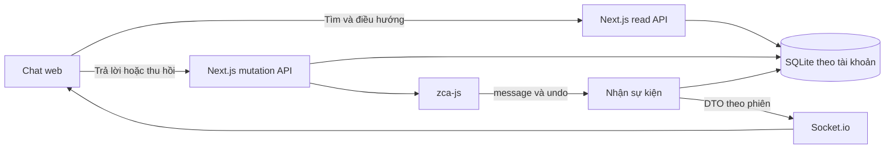

# Bổ sung luồng chat từ Zalolite

## Overview

Thêm ba thao tác còn thiếu trong `/chat` mà không thay đổi stack hay cách đăng nhập. **HOLD SCOPE**: lấy một nhóm tính năng từ Zalolite, không làm toàn bộ parity. Phạm vi không gồm nhiều tài khoản trong một trình duyệt, import `.zl.zip`, đồng bộ điện thoại, cuộc gọi, ẩn/khóa hội thoại, tìm trên máy chủ hay xóa phía tôi. Giữ nguyên gửi tin, tệp, sticker, chuyển tiếp, reaction và polling lịch sử nhóm hiện có.

## Giới hạn bản web

- Trình duyệt chỉ là giao diện; Next.js giữ kết nối Zalo qua `zca-js`. Đóng tab không đồng nghĩa server dừng, nhưng không hứa đồng bộ hay nhận thông báo khi server hoặc listener Zalo ngừng. Không bắt chước tích hợp hệ điều hành (Touch ID, Dock, phím tắt toàn hệ thống, chạy nền kiểu native).
- Lịch sử SQLite chỉ gồm những gì server đã lưu; không có quyền đọc dữ liệu/backup trên máy người dùng như native. Không đưa import backup, VoIP hay đăng nhập đa tài khoản vào đợt này.
- Tìm kiếm không đụng giao thức Zalo và có thể bàn giao riêng. Reply chỉ áp dụng cho tin văn bản đủ dữ liệu; thu hồi phụ thuộc định danh, quyền phía Zalo và sự kiện server nhận được. Không hiện thành công giả, không vẽ nút cho trường hợp chưa hỗ trợ. Kiểm chứng UI ưu tiên desktop và trình duyệt điện thoại, không lấy hành vi rê chuột làm đường truy cập duy nhất.

## Nguồn và quyết định

- Nguồn chỉ đọc: `../zalolite`, `main`, `2cfcf9c` (`v0.0.14`). Tham chiếu `docs/BA_FEATURE_COVERAGE.md`, `docs/adr/0006-native-transcript-and-history-pages.md` và `native/macos/CTDoNative/Tests/CTDoNativeTests/SearchAndReplyFocusTests.swift`. Đối chiếu bằng gói Repomix 7 tệp, 7.445 token, không có cảnh báo; không đóng gói dữ liệu tài khoản, credential hay capture. Ghi nhận `lebad280324` và upstream `ctdozlite` theo `NOTICE`; học hành vi và viết TypeScript mới, không sao chép mã/hình/tài nguyên MIT OR Apache-2.0.

| Chức năng | Zalolite | Web hiện tại | Chọn cho web |
| --- | --- | --- | --- |
| Tìm và nhảy | Tìm lịch sử đã lưu, cửa sổ có khóa `(ts, msg_id)`, focus và đếm kết quả | Sidebar tìm hội thoại; `messageStore.getMessages` đọc tối đa 200 tin/hội thoại | Tìm SQLite theo tài khoản/hội thoại, API cửa sổ quanh ID dùng lại để nhảy tới quote |
| Trả lời | Trích dẫn trong ô soạn, giữ focus và nháp | `/api/chat/send` gọi `api.sendMessage` với string; schema công khai chưa có preview | Giải `replyToId` server-side, gửi quote thật bằng `zca-js`, không mang metadata giao thức ra trình duyệt |
| Thu hồi | Hành động riêng, có giới hạn xác minh quyền trên Zalo | Có chuyển tiếp/reaction, không có đường hiện thực `undo` trong web | Dùng SDK `undo`, đồng bộ tombstone bền; không gọi API xóa phía tôi |

Rủi ro **trung bình**: 3 giả định quan trọng là self-echo trả đủ định danh, SDK cho tín hiệu thu hồi thành công/đến đúng thread, và sự kiện muộn không khôi phục nội dung. Chặn bật tính năng nào chưa chứng minh hợp đồng; fixture không thay cho nghiệm thu Zalo thật. Giữ chung xác thực Next.js và account scope SQLite, không nhúng Swift/Rust worker hoặc thêm service.

## Dependencies

Không có kế hoạch khác chặn. Ba pha chạy tuần tự vì dùng chung `app/chat/page.tsx` và `lib/messageStore.ts`. Giữ một stacked PR theo tính năng/pha; mỗi nhánh test-first và tự chạy được. Trong mỗi PR, đi từ contract/lưu trữ → route/listener → UI; không đổi schema theo hướng phá bản cũ, không deploy hay thử tài khoản thật từ kế hoạch này.

## Phases

| # | Phase | Status |
|---|-------|--------|
| 1 | [Tìm tin trong hội thoại](./phase-01-start.md) | Pending |
| 2 | [Trả lời trích dẫn](./phase-02-quoted-reply.md) | Pending |
| 3 | [Thu hồi tin nhắn](./phase-03-message-recall.md) | Pending |

## Success Criteria

- Tìm và nhảy tới tin cũ hơn 200 tin mới nhất mà không gửi nội dung tìm kiếm lên Zalo.
- Trích dẫn thật qua SDK, nháp không mất khi lỗi, click được tới tin gốc đã lưu.
- Thu hồi đúng tin, không lộ lại nội dung/media do ACK, history hoặc socket đến trễ, kể cả sau reload.
- Vitest theo từng pha và browser smoke trên `/chat`: dùng harness kiểm thử tạm, lưu SQLite riêng, seed dữ liệu tổng hợp, cung cấp HTTP/Socket.io tại ranh giới test; không thêm bypass xác thực hoặc fixture runtime vào mã chạy thật. Chỉ nghiệm thu live khi có phép riêng và tài khoản kiểm thử.

## Validation Log

- Đã đối chiếu `app/chat/page.tsx:316–383` (gộp live/history và auto-scroll), `lib/messageStore.ts:19–32,55–86` (scope, xung đột, giới hạn), `app/api/chat/messages/route.ts:7–23` (consumer chỉ đọc), `app/api/chat/history/route.ts:24–32` (nhập và gọi `getMessages`), `lib/zalo.ts:107,133,189–252` (self-listen/listener), `app/api/chat/send/route.ts:37–55` (ACK), `lib/chatIngest.ts:83–104` (media muộn) và khai báo `sendMessage`, `undo`, `Undo` của `zca-js@2.1.2` đang cài.
- `getMessages` giữ signature cho hai route hiện tại và các test store/ingest; `around` chỉ bổ sung nhánh đọc. Consumer Socket.io phải giữ hoạt động cho `/chat` và `/tien-ich/group-events`. Kiểm tra bằng Node trên SQLite in-memory: match NFC chữ Việt và `%_` literal, tài khoản khác không có kết quả; đây không phải benchmark ứng dụng.
- Không có quyết định sản phẩm cần hỏi thêm để viết kế hoạch. Hai cổng live riêng: xác nhận quote trên phía nhận và xác nhận self-undo đúng định danh trên cả chat 1-1/nhóm. Không có live verification ở bước lập kế hoạch.
- Triển khai: pha 1 đã qua Vitest và browser `/chat` với SQLite tổng hợp, gồm nhảy tới tin ngoài 200 tin mới nhất, đổi hội thoại lúc tìm và nhận tin mới khi đọc cửa sổ cũ. p95 SQLite in-memory, 10.000 tin: 14,96 ms với kết quả cũ nhất và 14,11 ms khi không khớp.
- Fixture pha 2–3 xác minh nháp khi gửi lỗi, focus trên màn hình 390 × 844, cập nhật thu hồi không để lại đoạn trích; Vitest kiểm tra reconnect, SQLite mở lại và chặn media đến muộn. `npm run build` hoàn tất; môi trường không có ESLint.
- Pha 2 và 3 **chưa nghiệm thu live**: giữ `ZALO_CHAT_REPLY_VERIFIED` và `ZALO_CHAT_RECALL_VERIFIED` tắt. SDK chỉ phân loại undo ở listener; không có fixture đã xác minh cho undo trong lịch sử nhóm, nên cách ly hàng nghi vấn thay vì ghi tombstone dựa trên phỏng đoán. Không dùng tài khoản thật, không deploy, không tạo commit hay PR.
- Hồi quy nhận tin chữ: [test `/chat`](../../app/chat/page.test.tsx) tái hiện lỗi khi Socket.io chuyển đối số tùy chọn `undefined` thành `null`. Sau bản sửa, Chrome với Socket.io thật và dữ liệu tổng hợp hiển thị cả tin chữ lẫn cập nhật ảnh trong hội thoại đang mở mà không gọi lại API lịch sử.
- Hồi quy nhận video: [test lưu media](../../lib/chatMedia.test.ts) tái hiện lỗi khi URL tải chuyển hướng trong CDN Zalo và kiểm tra chặn đích ngoài danh sách. Chrome phát và tua được MP4 qua API media và RustFS cục bộ với fixture; chưa xác minh video lỗi trên môi trường thật.

## Red Team Review

| Rủi ro kiểm chứng | Quyết định áp dụng |
| --- | --- |
| URL tìm có thể lọt vào access log | Gửi body, không ghi từ khóa ở pha 1 |
| Room cookie thô, SID trong log, callback phiên cũ | Xác thực socket và ràng buộc thế hệ trước khi mở reply ở pha 2 |
| ID legacy và kết quả undo không đủ nghĩa | Giữ ID lossless, dùng sự kiện đúng đích và trạng thái chưa xác nhận ở pha 3 |
| Một phiên nhận event; history, ACK và media có thể phát lại nội dung | Invalidation theo account, revalidate khi reconnect, tombstone ưu tiên ở pha 3 |

<!-- slug: zalo-chat-parity -->